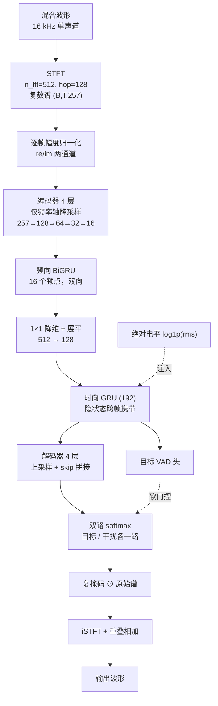

# VoiceFilter

单麦克风、多人同时说话的场景下，实时把**目标说话人**的声音从混合语音里提取出来。

全因果流式推理，算法延迟 **24 ms**，可训练参数 **0.42 M**，CPU 单核即可实时。
针对单个说话人做专用模型：不需要注册语音，网络权重直接拟合目标声线。

```
混合语音（你 + 室友） → VoiceFilter → 只有你的声音
```

## 特性

- **目标说话人提取**，不是降噪。判据是「这一点是不是**你**」，不是「这一点有没有人说话」
- **全因果**：训练与推理共用同一套 STFT，流式输出与批量前向逐样点一致（自检偏差 < 1e-7）
- **0.42 M 参数**，8 GB 显存训练、CPU 单核推理
- **自带 GUI**：训练一个选项卡，实时推理一个选项卡，设备可选、旁路可 A/B
- 纯 PyTorch，无外部模型依赖，不需要预先下载任何权重

## 架构



### 逐层形状与作用

| 阶段 | 操作 | 输出形状 | 说明 |
|---|---|---|---|
| STFT | Hann 窗 512 / 帧移 128 | `(B, T, 257)` 复数 | 32 ms 窗、8 ms 帧移，75% 重叠 |
| 归一化 | 逐帧 RMS 缩放 | `(B, 2, T, 257)` | cRM 本身尺度无关，先把各种电平拉平 |
| 编码器 | 4× 因果卷积，`stride=(1,2)` | `(B, 64, T, 16)` | 通道 2→16→24→32→64，只在频率轴下采样 |
| 频向 BiGRU | 16 个频点上双向 | `(B, 64, T, 16)` | 带残差；**整帧已到齐，非因果零延迟成本** |
| 降维展平 | 1×1 卷积 + reshape + Linear | `(B, T, 128)` | `32×16=512 → 128` |
| 时向 GRU | 单层 192 | `(B, T, 192)` | **唯一跨帧状态**，实际记忆 1–2 s |
| 解码器 | 4× 上采样 + skip 拼接 | `(B, 4, T, 257)` | 通道 48→32→20→12→4，时间核为 1 |
| 双路掩码 | 对「源」维 softmax | `(B, T, 257)` ×2 | 每个时频点归属目标 / 干扰 |
| iSTFT | 重叠相加 + 窗平方和归一 | `(B, 48000)` | 与训练同一套实现 |

### 三个关键设计

**1. 频率方向可以非因果，时间方向不能。**

一整帧的 257 个频点在 32 ms 窗口结束时就已经全部到齐，所以在频率轴上看「未来」
不花任何延迟。因此频向用 BiGRU（双向），把基频与各次谐波的依赖编码进特征——
音色主要体现在谐波包络上。时间轴则严格因果：所有卷积只左补零，GRU 单向。

**2. 双路掩码 + 干扰重建损失。**

不是输出一个「目标掩码」，而是输出两路，在每个时频点的 re/im 上做 softmax，
`m_target + m_interf = 1`。干扰支路也要真的把室友的声音重建出来（不输出给用户，
只提供梯度）。监督信号从「这一点该不该保留」变成「这一点归谁」——这是模型学会
**分辨**而不是**挑响的**的关键。

**3. 目标 VAD 头做软门控。**

单独预测「目标此刻是否在说话」，作为掩码的乘性门控。配合训练集里的空目标样本
（只有室友说话、目标轨全零），保证「该安静的时候真的安静」，而不是把室友的声音
漏过去。

### 参数量与算力分布

| 部件 | 参数 | 占比 | 前向算力 |
|---|---|---|---|
| 编码器 4 层卷积 | 20 K | 5% | 31% |
| 频向 BiGRU + 1×1 | 21 K | 5% | <1% |
| proj_in + 时向 GRU + proj_out | 350 K | **84%** | 18% |
| 解码器 5 层卷积 | 26 K | 6% | **51%** |

两者几乎完全错开：参数集中在时序主干，算力集中在卷积。想加容量就加宽 GRU 或
`d_model`（几乎不增耗时），想提速就砍解码器在高频段的通道。

### 为什么是 24 ms

延迟不是靠缓冲凑出来的，而是分帧本身决定的。左补零 `n_fft - hop = 384` 样点后，
帧 `k` 覆盖 `[k·hop − 384, k·hop + 128)`；算完第 `k` 帧时，原始时间轴上
`k·hop − 384` 之前的样点才全部定稿。所以算法延迟恰为 **384 样点 = 24 ms**，
加上设备缓冲，端到端 60–90 ms。

流式推理需要携带的状态只有三样：

| 状态 | 内容 |
|---|---|
| 卷积历史 ×9 | 编码器 4 层各 k−1 帧，解码器只有 dc0 需要 2 帧 |
| GRU 隐状态 ×1 | `(1, 1, 192)` |
| OLA 累加器 | 重叠相加缓冲 + 窗平方和 |

其余全部是无状态的逐帧计算。`train.py --dry` 的第 5 项正是在验证流式与批量
逐样点一致，这一项不过就说明状态管理有问题。

### 训练目标

```
L = 1.0 · (−SI-SNR)           目标语音重建，尺度无关
  + 0.5 · MR-STFT             三组分辨率（512/256/128）的谱收敛 + 对数幅度 L1
  + 0.3 · (−SI-SNR)           干扰支路重建（只提供梯度，不输出）
  + 0.1 · BCE(VAD)            帧级目标活动
  + 0.5 · 空目标能量惩罚        只有室友说话时，把输出压向静音
```

> 训练日志里的 loss 是**负数且没有下界**，因为主导项是 `−SI-SNR`。
> 负得越多越好，`sisnr` 那一项约等于训练集上的 `−SI-SDR(dB)`。

## 数据准备

只需要两个文件夹：

```
data/
  me/      你的录音     在目标位置、用目标麦克风、其他人安静时录
  dorm/    干扰录音     你不出声时录，其他人正常聊天
```

**三条硬性要求**，做不到的话效果上限会明显下降：

1. **同一支麦克风、同一个房间、同一个位置。** 如果目标语音是在别处录的干声，
   混进去之后模型学到的其实是「去混响」，到真实场景会把你的声音削得发闷。
2. **`dorm/` 里绝对不能有目标说话人的声音。** 混进一段自己，模型会学成
   「把你也当干扰去掉」。
3. **`me/` 要覆盖声线的变化**：不同天的状态、朗读和随口说话、轻重音、不同距离。
   专用模型没有注册语音可依赖，训练集没见过的那档状态它就不认识。

其他：

- 格式 wav / flac / ogg 直接读，mp3 / m4a 先转：`ffmpeg -i in.m4a -ac 1 -ar 16000 out.wav`
- 采样率随意，内部自动重采样到 16 kHz 单声道
- 单个文件最长 5 分钟没问题，启动时全量解码进内存（零磁盘 IO）
- 训练 / 验证**按文件划分**（默认 10% 进验证集），同一段录音不会两边都出现
- 目标语音建议 ≥30 分钟；干扰录音重点是**说话人多样性**，10–20 分钟来自
  不同时段、不同人数比一小时的同两个人有效得多

### 训练时怎么造样本

四类混合样本按比例随机采样：

| 类型 | 构造 | 目标轨 | 占比 | 教什么 |
|---|---|---|---|---|
| P1 重叠 | 室友说话 + 目标叠加，SIR −5～+10 dB | 你的语音 | 55% | 真正的分辨能力 |
| P2 空目标 | 只有宿舍声音 | 静音 | 15% | 该安静就安静，防泄漏 |
| P3 纯目标 | 宿舍静音 + 你说话 | 你的语音 | 15% | 防过抑制，保住音色 |
| P4 边界 | 你起止、室友持续 | 你的语音 | 15% | 门控起落平滑 |

叠加前还会做三件事：**LTAS 谱包络匹配**（把目标语音的谱整形成宿舍录音的样子）、
**合成房间冲激响应**（T60 0.2–0.55 s）、**随机增益**。不做这些，模型学到的会是
「留下亮的、去掉暗的」，而不是「留下你」。

## 安装

```bash
git clone https://github.com/yazi-au/VoiceFilter.git
cd VoiceFilter
pip install -r requirements.txt
```

Python 3.9+（实测 3.12）。GPU 训练请装 CUDA 版 PyTorch：

```bash
pip install torch --index-url https://download.pytorch.org/whl/cu124
```

Linux 上跑 GUI 还需要 `sudo apt install python3-tk`，且 `sounddevice` 要能找到音频设备。

## 训练

### 图形界面

```bash
python app.py
```

「训练」选项卡里选两个文件夹和输出目录，点「从头训练」。训练跑在子进程里，
日志实时回显，可随时中断。想换一个带 CUDA 的解释器训练，把它填进
「Python 解释器」那一栏，点「检测环境」确认 `available True`。

Windows 上也可以双击 `run.bat`（它按 `VOICEFILTER_PYTHON` 环境变量 →
同目录 `python_path.txt` → PATH 里的 `python` 的顺序找解释器）。

### 命令行

```bash
python train.py --dry                       # 自检，不需要数据
python train.py --stats --target_dir data/me --interf_dir data/dorm
python train.py --target_dir data/me --interf_dir data/dorm
python train.py --set seg_sec=4.0 batch=32 lr=3e-4
python train.py --resume ckpt/last.pt
```

`--dry` 不需要任何数据，验证 STFT 互逆、参数量、批量前向、**流式与批量是否逐样点
一致**、反向传播：

```
[1] STFT/iSTFT 往返：帧数=378 频点=257 误差=8.94e-08
[2] 可训练参数：0.417 M  (f_final=16, delay=384 样点 = 24.0 ms)
[4] 批量前向：输出谱 (1, 378, 257)  vad (1, 378)
[5] 流式 vs 批量：最大偏差 3.73e-08  (应 < 1e-4)
```

产物是 `<ckpt_dir>/best.pt`（验证最好）和 `last.pt`（最新）。

### 看哪些指标

```
[val] SI-SDR 7.14 dB  SI-SDRi +8.28 dB  泄漏 -16.4 dB  纯目标 SI-SDR 44.94 dB
```

| 指标 | 含义 | 关注点 |
|---|---|---|
| **SI-SDRi** | 相对输入的提升，主指标 | 只在「有目标且有干扰」的样本上统计 |
| **泄漏** | 只有室友说话时的输出能量 | 应 ≤ −25 dB，恶化说明模型开始「放行」 |
| **纯目标 SI-SDR** | 只有你说话时的保真度 | 掉下去说明过抑制，会加金属感 |

三个必须一起看。只看 SI-SDRi 容易训出一个「宁可全静音」的模型。

## 实时推理

`app.py` 的「实时推理」选项卡：

1. **模型**：选 `.pt`，或直接选包含 `best.pt` 的目录
2. **输入设备**：你的麦克风（Windows 上带 `[Windows WASAPI]` 的通常延迟最低）
3. **输出设备**：耳机；想接管通话就选 **VB-Cable / VoiceMeeter** 的输入口，
   再在 Zoom / Discord 里把麦克风设成同一路
4. 点「启动」。勾「旁路」直通原始输入做 A/B 对比

界面有输入 / 输出电平条和目标 VAD 指示灯。推理默认跑在 CPU 上——每 8 ms 一帧
往 GPU 送，kernel 启动开销比计算本身还大，反而更慢。

也可以不用 GUI，直接用流式封装：

```python
import torch
from config import Cfg
from model import TSE
from stream import StreamingTSE

cfg = Cfg()
model = TSE(cfg)
model.load_state_dict(torch.load("ckpt/best.pt", map_location="cpu")["model"])
model.eval()

st = StreamingTSE(model, cfg)
for block in mic_blocks:          # 任意块长，通常 128 样点 = 8 ms
    out = st.process(block)       # 输出与输入等长，滞后 24 ms
```

## 文件结构

```
config.py     所有超参
audio.py      读取、重采样、LTAS 匹配、合成 RIR
stft.py       STFT / iSTFT，训练与流式共用同一套数学
data.py       四类混合样本的在线生成
model.py      网络定义
losses.py     SI-SNR、多分辨率谱损失、空目标惩罚
train.py      训练循环、验证、自检
stream.py     流式封装（卷积历史、GRU 状态、OLA 缓冲）
app.py        图形界面（训练 / 实时推理）
run.bat       Windows 启动脚本
```

## 设计取舍

**用 GRU 不用 Transformer。** 375 帧上的自注意力是 O(T²)，且必须开窗才能流式；
GRU 是 O(T)，状态天然可携带。对 1–2 s 的上下文需求，循环层的性价比高得多。

**频率方向用 BiGRU 而不是堆卷积。** 16 个频点上的全频依赖（基频 + 各次谐波），
一层双向 GRU 就够，而且整帧已到齐，双向不要钱。卷积要达到同样感受野得堆 7 层以上。

**解码器砍得狠，但 skip 没砍。** 掩码的高频细节由编码器原样带过来的 skip 提供，
解码器只负责融合和上采样。压缩的是解码器自己的通道，不是信息通道。

**为什么不用分离 + PIT。** 分离出 N 路再挑一路确实更通用，但输出路数与人数耦合，
人数一变就得重训；为「分离 + 选择」付出的容量也比「直接提取」多。
本项目只需要保留一个人，直接提取更划算。

## 已知边界

- 两个人**同性别、音高接近、0 dB 重叠**是最难的情况。0.42 M 参数的因果模型
  在这一档大概能做到 7–11 dB 的 SI-SDRi。再往上要么加模型，要么上麦克风阵列——
  单麦在物理上就没有更多信息了。
- 特征的频率分辨率是瓶颈：瓶颈处只剩 16 个频点（约 500 Hz 一格），音高相近、
  谐波重叠的两个人在这里就已经混在一起，解码器再精细也分不开。此时模型靠的是
  韵律线索（基频轨迹、语速、停顿习惯）。
- 专用模型的软肋是**声线漂移**：感冒、换麦、换房间、长时间说话后嗓子变了，
  效果都会下降。办法是把那些状态录进训练集，或重新训练。

## 许可

暂未指定。如需开源授权请自行添加 `LICENSE`（MIT / Apache-2.0 都是常见选择）。
